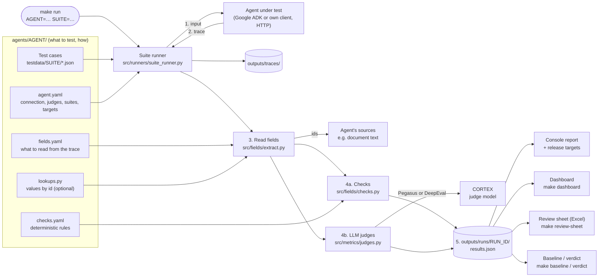
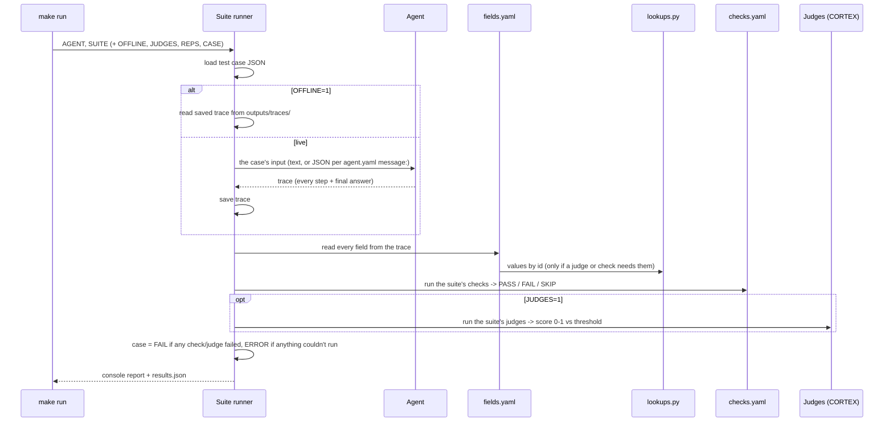

# AI Eval Suite

An **agent-agnostic offline evaluation framework** for AI agents. It asks the agent every test
question, saves the agent's trace, reads what it needs from the trace, scores it with deterministic
checks and LLM judges, and reports pass / fail against release targets. Onboarding an agent is a new
folder under `agents/` — configuration only, no framework code.

**First time here? Set up with [SETUP.md](SETUP.md)** — step by step, from a fresh clone to your
first run. This README explains how the framework is built and how to use it.

### Agents evaluated today

| Agent | Folder | What it is | Details |
|---|---|---|---|
| Knowledge Agent | `agents/knowledge_agent/` | answers colleagues' questions from the knowledge base (RAG) | [agents/knowledge_agent/README.md](agents/knowledge_agent/README.md) |
| Demo | `agents/demo_001/` | the skeleton `make new-agent` creates (placeholders) | its `agent.yaml` |

## Contents

- [Purpose](#purpose) · [How it works](#how-it-works) · [Architecture](#architecture) · [Words used here](#words-used-here)
- [Project layout](#project-layout) · [Everyday commands](#everyday-commands) · [Suites](#suites)
- [Read the results](#read-the-results) · [Where do I change…?](#where-do-i-change)
- [A test case](#a-test-case) · [Metrics](#metrics) · [CORTEX and Pegasus](#cortex-and-pegasus)
- [Trace fields and checks](#trace-fields-and-checks) · [Add an agent](#add-an-agent)
- [Import test cases from a spreadsheet](#import-test-cases-from-a-spreadsheet) · [Synthesizer](#synthesizer-generate-test-cases)
- [SME review sheet and judge calibration](#sme-review-sheet-and-judge-calibration)
- [Release targets and consistency](#release-targets-and-consistency) · [Baseline and verdict](#baseline-and-verdict)
- [Pass, fail, skip, error](#pass-fail-skip-error) · [Troubleshooting](#troubleshooting)

## Purpose

LLM agents change with every prompt, model or retrieval tweak, and their answers vary from run to run.
This framework answers, for any agent, before a release:

| Question | How |
|---|---|
| Is the answer correct, relevant and grounded? | LLM judges (Pegasus / DeepEval on CORTEX) with per-metric thresholds |
| Did each stage of the agent do its job? | deterministic checks and judges on any value in the agent's trace, not only the final answer |
| Is it safe? | privacy, hallucination and refusal checks |
| Is this build good enough to ship? | release targets: pass rates across a whole suite |
| Is it worse than the last good build? | baseline and verdict: the same cases, several repetitions, compared within tolerances |
| Do the judges agree with the experts? | an SME review sheet and calibration report |

**Offline** means the evaluation runs outside production on prepared test cases: it calls a deployed
test instance of the agent (or replays saved traces with `OFFLINE=1`), never live user traffic.

Use cases: a release gate in CI, regression checks after a model or prompt change, stage-level
diagnosis of a quality drop, and building test sets (spreadsheet import, synthetic generation).

## How it works

For every test case of a suite, `make run AGENT=<agent> SUITE=<suite>`:

1. **calls the agent** with the case's input (HTTP; Google ADK by default),
2. **saves the trace** — the agent's record of every step and the final answer,
3. **reads the input and expected values** from the test case (`testdata/<suite>/*.json`),
4. **reads fields out of the trace** — one JMESPath query per field in `fields.yaml`; values the trace
   only names by id (e.g. a document's text) are fetched by the agent's own `lookups.py`,
5. **scores** them:
   - **deterministic checks** (`checks.yaml`) — rules with a clear yes / no, e.g. "every cited source
     is in the evidence", "answered within 60 s", "retrieved the expected document";
   - **LLM judges** (`agent.yaml` → `metrics:`) — a judge model on CORTEX scores 0–1 what a rule
     can't, e.g. correctness against the golden answer, faithfulness to the sources; pass at or above
     the threshold. Pegasus runs them when installed, DeepEval otherwise,
6. **reports** pass / fail per case, pass rates across the run, and the suite's **release targets**,
7. **keeps the results** (`outputs/runs/<run id>/results.json`) for the dashboard, the SME review
   sheet, and comparing a new build with a saved **baseline** (verdict).

Everything agent-specific lives in `agents/<agent>/` (YAML, plus small optional Python). `src/` is
the same for every agent — you should never need to edit it to onboard an agent or change metrics.

## Architecture

### Components



### One test case, end to end



### Design principles

- **Configuration over code.** An agent is YAML: connection, metrics, suites, fields, checks. Python only
  for what YAML can't express (`lookups.py`, `parser.py`, `client.py`).
- **The trace is the only evidence.** What the agent doesn't log can't be tested — e.g. "Precision@5"
  is measured on the candidates the trace logs, not on the whole search index.
- **Judges and checks are separate.** Checks are free and exact; judges cost a model call and are
  calibrated against SMEs. Each suite picks which of each it runs.
- **Errors are never scores.** An unreachable agent or judge is an ERROR — never a pass, a skip or 0.
- **Repeatable.** Judges run at temperature 0, every run is saved, and baselines are committed.

## Words used here

| Word | Meaning |
|---|---|
| **agent** | the AI application under test; one folder `agents/<agent>/` each |
| **test case** | one JSON file: `input` (the question) and an optional `expected` block (golden answer, expected sources, keywords …) |
| **suite** | a named set of test cases + the judges and checks run on them (`agent.yaml` → `suites:`); cases in `testdata/<suite>/` |
| **trace** | the agent's own record of one answer; saved to `outputs/traces/<agent>/<suite>/<case>.json` |
| **field** | a value read from the trace, e.g. `answer`, `retrieved_ids` (`fields.yaml`) |
| **check** | a deterministic rule on fields → PASS / FAIL / SKIP (`checks.yaml`) |
| **diagnostic check** | a check shown on every case that never fails it; its pass rate can still be a target |
| **judge / metric** | an LLM scoring a field 0–1; PASS at or above its threshold |
| **lookup** | a value fetched outside the trace by id, by the agent's `lookups.py` (e.g. a document's text) |
| **domain** | a business area an agent's test cases are grouped by (`domains.yaml`, optional) |
| **target** | a pass-rate bar for the whole run, e.g. correctness ≥ 90% |
| **baseline / verdict** | a trusted build's saved results / a new build compared with them |
| **OFFLINE=1** | replay saved traces instead of calling the agent |
| **JUDGES=0** | checks only, no LLM judges |
| **REPS=n** | ask every question n times (consistency) |
| **SME** | subject-matter expert who marks answers, to check the judges agree with a human |

## Project layout

```
Makefile                        every command (make help)
scripts/setup.sh                what `make setup` does (uv sync + Pegasus + CorteX DevKit)
metric_library.yaml             built-in metrics: Pegasus class, DeepEval fallback, fields they need
env/
  .env.example                  every setting, documented — `make setup` copies it to env/.env
  .env                          your values: CORTEX, agent URLs, source credentials (not committed)
  .env.<agent>                  optional, one agent's values; override env/.env    (not committed)
agents/
  <agent>/                      everything about one agent lives in its folder
    README.md                   what the agent is and how it is evaluated
    agent.yaml                  connection, metrics (+ thresholds), suites, targets
    checks.yaml                 deterministic checks, in groups (optional)
    fields.yaml                 what to read from the trace, one line per field (optional)
    testdata/<suite>/*.json     test cases, one per file
    rubrics/*.md                custom judge criteria, in plain English     (optional)
    domains.yaml                business areas: official names + aliases   (optional)
    importers/*.yaml            spreadsheet column mappings (make import-cases) (optional)
    synth/                      test-case generator: synth.yaml, styles/, instructions.md (optional)
    lookups.py                  values looked up outside the trace by id   (optional)
    parser.py                   Python for what fields.yaml / checks: can't express  (optional, rare)
    client.py                   only for agents that are not Google ADK     (optional)
  _template/                    what `make new-agent` copies
src/                            the framework — src/__init__.py has a map of it
  cli.py                        every make command lands here (python -m src ...)
  core/                         paths, env files, HTTPS certificates (tls), agent.yaml loading, domains, results, errors
  clients/                      adk_client (the agent), cortex_client (judge model: API key or DevKit), athena_client
  runners/                      suite_runner (steps 1-6 for every case), test_cases (loading test data)
  fields/                       extract (fields.yaml), checks (checks.yaml), lookup (lookups.py), preview (make fields)
  importers/                    spreadsheet -> test cases (make import-cases)
  exporters/                    test cases -> Excel workbook (make export-cases)
  metrics/                      library (which metrics exist), judges (engine rule + DeepEval + Pegasus)
  verdict/                      baseline (save), compare (verdict + tolerances)
  reporting/                    console report, dashboard.py (Streamlit), review sheet, calibration
  synthesizer/                  generator, settings, documents, output_template,
                                sources/ (athena_mcp, files, json_records)
  onboarding/                   new_agent (make new-agent), doctor (make doctor)
  utils/                        adk_trace (helpers for parser.py), text, html_text
tests/                          the framework's own tests (make test)
baselines/<agent>/<suite>.json  committed, so the team compares against the same baseline
outputs/traces/                 latest trace per case (committed ones are offline fixtures)
outputs/runs/<run id>/          results.json + that run's traces (not committed)
```

Every file starts with a comment saying what it does, who uses it and what you'd change there.
Reading order for the code: `src/runners/suite_runner.py` → `src/metrics/judges.py` →
`src/verdict/compare.py` → `src/clients/`.

**In a parser**, import the helpers from the framework:

```python
from src.core.results import check                                    # a deterministic check
from src.utils.adk_trace import state, find_event, event_json, tool_calls  # read the ADK trace
```

## Everyday commands

| I want to…                                  | Command |
|---------------------------------------------|---------|
| check this machine is ready                 | `make doctor` |
| sign in to CORTEX with the DevKit (once)    | `make cortex-login` |
| see agents, suites and their metrics        | `make list` |
| create a new agent                          | `make new-agent NAME=claims_agent INPUT_FIELD=claim_id` |
| run a suite                                 | `make run AGENT=<agent> SUITE=sanity` |
| run only some cases                         | `... CASE="TC_001 TC_002"` |
| rerun without calling the agent             | `... OFFLINE=1` |
| skip the LLM judges (fast, free)            | `... JUDGES=0` |
| run every case several times                | `... REPS=5` |
| save a stable build as the baseline         | `make baseline AGENT=.. SUITE=.. BUILD=1.4.0 REPS=5` |
| check a new build against the baseline      | `make verdict  AGENT=.. SUITE=.. BUILD=1.5.0 REPS=5` |
| import test cases from Excel / CSV          | `make import-cases AGENT=<agent> FILE="~/Downloads/golden.xlsx" [DRY_RUN=1]` |
| export test cases to one Excel workbook     | `make export-cases AGENT=<agent> [SUITE=golden] [FILE=~/Desktop/cases.xlsx]` |
| fetch source documents for the synthesizer  | `make sources AGENT=<agent> [GROUP="…"] [IDS="…"]` |
| generate test cases from them               | `make goldens AGENT=<agent> [GROUP=…] [IDS=…]` |
| pass rate of every check / judge over the last N runs | `make summary AGENT=<agent> SUITE=golden LAST=10` |
| look at results                             | `make dashboard` |
| SME review sheet for a run (judge calibration) | `make review-sheet AGENT=<agent> SUITE=golden [RUN=<run id>]` |
| judge vs SME agreement, best threshold      | `make calibrate FILE=outputs/review/<run id>.xlsx` |
| test the framework itself                   | `make test` |

Every command exits with 1 when something failed, so it drops straight into CI.

## Suites

A suite is a folder of test cases plus the judges and checks run on them, defined in `agent.yaml` →
`suites:`. `make list` shows every agent, suite and its judges.

```yaml
suites:
  sanity:                                    # cases in testdata/sanity/
    metrics: [relevance, faithfulness]       # LLM judges this suite runs
    targets: {case_pass_rate: 1.0}           # release targets (pass rates across the run)
  golden:
    metrics: [correctness, faithfulness]
    checks: [answer, retrieval]              # check groups and/or names: all (default) | none | [...]
    targets: {correctness: 0.90, error_rate: 0.05}
  consistency:
    testdata: testdata/golden                # reuse another folder's cases
    only: {metadata.consistency_set: true}   # ... only those whose metadata matches
    metrics: [correctness]
  diagnose:
    testdata: testdata/golden
    traces: golden                           # with OFFLINE=1, replay the golden suite's saved traces
    metrics: [intent_preservation]
```

**Design suites by question, not by size.** Each suite should answer one question with only the judges
that answer it — LLM judges cost a CORTEX call per case and repetition, deterministic checks are free
(they read the saved trace) and skip themselves when a case lacks the data. A typical set:

| Suite | Question it answers | When |
|---|---|---|
| sanity | is this build alive and sane? | every deploy / PR |
| golden | is it good enough to release? (SME-approved cases, release targets) | every release candidate |
| consistency | does it give the same answer every time? (`REPS=3..5`) | release, baseline, after a model / prompt change |
| coverage | how does it do across every domain and question type? (generated cases) | weekly |
| negative / safety | does it refuse what it should, and keep personal data out? | every release candidate |
| diagnose | why did a score drop? (stage-level judges on saved traces) | on demand |

See [agents/knowledge_agent/README.md](agents/knowledge_agent/README.md) for a complete real set.

Flags for any `make run` / `baseline` / `verdict`: `CASE="ID1 ID2"` (only these cases),
`OFFLINE=1`, `JUDGES=0`, `REPS=5`, `BUILD=1.5.0` (label the run with the agent build), `METRICS="a b"` (only these judges).

**Time and cost:** a live case takes as long as the agent (often 10–60 s) plus one call per judge.
100 cases × `REPS=5` × 6 judges is 500 agent calls and ~3,000 judge calls — hours. Try one case with
`CASE=` first.

## Read the results

Every run's results appear in four places:

1. **Console** — per case `PASS` / `FAIL` / `ERROR`, one indented line per failure
   (`FAIL  check:<name> <reason>`; judges as `PASS  judge:relevance score=0.86/0.7 [pegasus]` =
   score / threshold [engine]), then the pass rate of every check and judge, then the release
   targets (MET / MISSED). The exit code is 0 only when everything passed, so it works in CI.
2. **`outputs/runs/<run id>/results.json`** — everything: per case every check and judge (status,
   score, threshold, engine, reason) and every field read from the trace. Run ids look like
   `20261008_013336_104_<agent>_sanity`.
3. **Dashboard** — `make dashboard` (http://localhost:8501; choose agent, suite and run on the left):

   | Tab | Shows |
   |---|---|
   | Overview | verdict, release targets, pass rate of every judge and check, a case × result grid |
   | Test cases | per case (problems first): question, answer, golden answer, evidence; judges and checks; errors with how to fix them; inside: every field read from the trace, stage timings, the test case, the raw trace |
   | Consistency | `REPS>1` runs only: the agent's `consistency:` fields for every repetition side by side, and each run's answer |
   | Trends | recent runs of the same suite |
   | Baseline | this run against the saved baseline (a `make verdict` run opens its own release view — see [Baseline and verdict](#baseline-and-verdict)) |
4. **Rates over many runs** — `make summary AGENT=<agent> SUITE=golden LAST=10`.

**When a case fails:** read the reason on the console line → `make fields AGENT=<agent> SUITE=<suite>
CASE=<id>` to see the values the check looked at → the dashboard's Test cases tab (pipeline fields,
raw trace). Then decide: agent bug (report it with the case id and trace file), wrong test data
(fix the case), or wrong check / threshold (change it — agree that with the team first).

## Where do I change…?

| I want to…                                        | Change this |
|---------------------------------------------------|-------------|
| add a new agent                                   | `make new-agent NAME=my_agent INPUT_FIELD=question` |
| point an agent at a different URL / app / headers | `env/.env`, or `connection:` in `agents/<agent>/agent.yaml` |
| add or edit test cases                            | `agents/<agent>/testdata/<suite>/*.json` |
| add a suite (regression, goldens, …)              | `suites:` in `agents/<agent>/agent.yaml` + a `testdata/<suite>/` folder |
| choose which metrics a suite runs                 | `suites:` → `metrics: [...]` in `agents/<agent>/agent.yaml` |
| change a threshold                                | `metrics:` in `agents/<agent>/agent.yaml` |
| add / remove a **Pegasus** (or DeepEval) metric   | `metric_library.yaml` — then use it by name in any agent |
| the judges' LLM temperature (all judges)          | `judge_temperature:` at the top of `metric_library.yaml` (default 0.0) |
| add a custom judge for one agent                  | a rubric in `agents/<agent>/rubrics/` + one line under `metrics:` |
| read a value from the trace (a stage output, …)   | one line in `agents/<agent>/fields.yaml`; preview with `make fields` — see [Trace fields and checks](#trace-fields-and-checks) |
| judge a stage output (rewritten query, tool, …)   | a field in `fields.yaml`, then point the metric at it (`answer: rewritten_query`) |
| add a deterministic check for one agent           | `agents/<agent>/checks.yaml` (YAML), or `checks()` in `parser.py` for real logic |
| send more than the question to the agent (e.g. question_type) | `message: {format: json, fields: {...}}` in `agent.yaml` |
| group test cases by business area / domain     | `agents/<agent>/domains.yaml` — see [Domains](#domains-business-areas) |
| use a Pegasus metric outside RAG (e.g. agentic)   | an entry with `module:` + `columns:` in `metric_library.yaml` (see `response_alignment`) |
| choose which checks a suite runs                  | `checks: all \| none \| [groups or names]` under the suite in `agent.yaml` |
| the agent's trace format changed                  | `make fields AGENT=.. CASE=..` shows which fields came back empty; fix their paths in `fields.yaml` |
| evaluate an agent that isn't Google ADK           | `agents/<agent>/client.py` (copy `client.py.example`) |
| turn a spreadsheet of test cases into JSON        | `agents/<agent>/importers/<name>.yaml` — see [Import test cases from a spreadsheet](#import-test-cases-from-a-spreadsheet) |
| generate test cases from documents (synthesizer)  | `agents/<agent>/synth/` — see [Synthesizer](#synthesizer-generate-test-cases) |
| judge model / CORTEX / Pegasus / Athena settings  | `env/.env` |
| regression tolerance for verdicts                 | `PASS_RATE_DROP`, `SCORE_DROP` at the top of `src/verdict/compare.py` |
| CORTEX with an API key, or with the DevKit        | `CORTEX_AUTH=api_key` or `devkit` in `env/.env` (see [CORTEX and Pegasus](#cortex-and-pegasus)) |
| CORTEX timeout / retries / API key                | `CORTEX_TIMEOUT_S`, `CORTEX_RETRIES`, `CORTEX_API_KEY` in `env/.env` |
| SSL certificate errors (office proxy)             | `VERIFY_TLS=false` or `CA_BUNDLE=...` in `env/.env` (one setting for every call) |
| Pegasus "not installed" warning                    | SAR token in `env/.env`, then `make setup` ([SETUP.md](SETUP.md), Step 5); check with `make doctor` |
| an endpoint, header or auth scheme changed        | the matching file in `src/clients/` |
| add a new kind of synthesizer source (an API, …)  | one new file in `src/synthesizer/sources/` (copy `json_records.py`) |

You should never need to edit `src/` to onboard an agent or change metrics.

## A test case

```json
{
  "test_case_id": "TC_012",
  "description": "Refund request after the 30-day window",
  "input":    { "question": "Can a customer get a refund after 30 days?", "question_type": "yes_no" },
  "expected": {
    "keywords": ["30 days"],
    "expected_answer": "No. Refunds are only possible within 30 days, except ...",
    "expected_source_ids": ["8194"]
  },
  "metadata": { "origin": "SME", "approval_status": "APPROVED" }
}
```

- `input.<input_field>` (from agent.yaml) is sent to the agent. Other input keys are sent too when
  `agent.yaml` has `message: {format: json, fields: {...}}`; use `message_template:` if the agent needs
  the input wrapped in a sentence.
- Everything in `expected` is optional. `keywords` are checked for every agent; anything else is
  used by that agent's `checks.yaml` (or `parser.py`) or by judges.
- A judge or check that needs something the case doesn't have (e.g. `correctness` without
  `expected_answer`) is **skipped** for that case and shown as skipped.
- `metadata` is free-form: suites can filter on it (`only: {metadata.approval_status: APPROVED}`).
- One file can also hold many cases: `{"cases": [ {...}, {...} ]}`.

## Metrics

**Built-in metrics** live in `metric_library.yaml`. Each entry says which Pegasus class and/or
DeepEval class implements it and which fields it needs:

```yaml
faithfulness:
  needs: [question, answer, contexts]
  pegasus: Faithfulness              # used when Pegasus is installed
  deepeval: FaithfulnessMetric       # used otherwise
```

To add a Pegasus metric, add an entry with its class name from `pegasus.metrics.rag` (another module:
`module:` + `columns:`, see the top of `metric_library.yaml`). To remove one, delete the entry.
Available today: relevance, faithfulness, correctness, context_precision, context_recall (Pegasus +
DeepEval), hallucination and privacy_leakage (Pegasus safety only), response_alignment (Pegasus agentic only),
contextual_relevancy, summarization (DeepEval).

`hallucination` is Pegasus' **safety** Hallucination: an LLM judge that checks the answer against the
sources the agent used (`contexts`) for fabricated details,
contradictions, unsupported claims and misattribution. It needs no golden answer, so it runs on every
case. Raw score 1-10 (9-10 none, 7-8 minimal, 5-6 moderate …), normalised to 0..1, higher is better;
a threshold of 0.66 = raw 7 ("minimal"). It has no DeepEval fallback (DeepEval's version scores
the other way round), so without Pegasus it is an ERROR.

`privacy_leakage` is Pegasus' safety PrivacyLeakage: it reads only the answer text (plus a `background:`
set in the agent's agent.yaml saying what is and isn't personal data there) and scores how much PII it
exposes — 24 categories, from names and account numbers to health details. Same 1-10 scale, higher is
better. Point it at another field (`answer: rewritten_query`) to check what the agent sends onwards, not
only what it answers. Test it with questions containing made-up personal details; never use real
customer data in test cases.

**An agent uses metrics by name** in its `agent.yaml`, with its own thresholds, and adds its own
rubric-based judges:

```yaml
metrics:
  relevance:   {threshold: 0.7}                    # from metric_library.yaml
  correctness: {threshold: 0.8}
  intent_preservation:                             # custom judge (DeepEval GEval)
    rubric: rubrics/intent_preservation.md
    answer: rewritten_query                        # judge the rewritten query, not the final answer

suites:
  sanity:     {metrics: [relevance]}                            # quick: one metric
  e2e:        {testdata: testdata/sanity, metrics: [relevance, correctness, intent_preservation]}
  regression: {metrics: [relevance, correctness]}               # data in testdata/regression/
```

**Judge temperature.** Every judge (Pegasus and DeepEval) runs at `judge_temperature` from the top of
`metric_library.yaml` — `0.0`, so the same answer gets the same score from run to run (as far as the
model allows). It is saved with each run, and `make verdict` notes when the baseline used another value.
A Pegasus metric whose `evaluate()` doesn't accept a temperature runs at the model's default, with a warning.

**Which engine runs a metric — one rule:** a custom rubric runs on DeepEval GEval; a library metric
runs on **Pegasus if it has a `pegasus:` class and Pegasus is installed**, otherwise on DeepEval.
`engine: deepeval` on a metric forces DeepEval (rarely needed). `method: ragas` passes a Pegasus method.

**What a judge sees.** Judges read four standard fields:

| field             | default value |
|-------------------|---------------|
| `question`        | the case input sent to the agent |
| `answer`          | the agent's final answer |
| `contexts`        | the trace's `context` (retrieved documents), if any |
| `expected_answer` | the case's `expected.expected_answer` |

`fields.yaml` can override them and add more (e.g. `rewritten_query`, `source_titles`), and a metric
can read a standard field from any of them (`answer: rewritten_query`). Custom rubrics
judge `question` + `answer` unless you list more: `needs: [question, answer, contexts]`.

## CORTEX and Pegasus

How to set them up: [SETUP.md](SETUP.md), Steps 4–7. How they work:

### CORTEX: API key or DevKit

All judges and the synthesizer talk to CORTEX. Choose how in `env/.env`:

| `CORTEX_AUTH=` | What you set up | Notes |
|---|---|---|
| `api_key` (default) | `CORTEX_HOST`, `CORTEX_CLIENT_ID`, `CORTEX_API_KEY` | calls the gateway directly |
| `devkit` | the SAR token (below), `make setup`, then `make cortex-login` once | CorteX DevKit: SSO in the browser, no API key; the DevKit finds the CorteX host itself (`CORTEX_ENV=int\|pre\|prd` pins one) |

Pegasus signs its own CORTEX calls. With `devkit` it uses Pegasus' own DevKit support
(`get_model(adapter="cortex_v2", auth_mode="devkit", cortex_env=...)`), so no key is needed (`CORTEX_ENV`, default `prd`). With `api_key` it uses `CORTEX_API_KEY`
(or client id + secret).
`make doctor` checks whichever mode you chose and makes one test call.

### Pegasus

Pegasus (`lbg-pegasus`) and the CorteX DevKit (`cortex-devkit`) come from SAR, so they need your SAR
token — the same token the Pegasus guide puts in `pip.conf`. The project is already set up for both
(`pyproject.toml`: their SAR indexes and the `pegasus` / `devkit` groups, the guides' "uv option").
Installing them needs only your SAR token in `env/.env` and `make setup` ([SETUP.md](SETUP.md), Step 5);
the steps are in `scripts/setup.sh`. The token is handed to uv for that one command and stored nowhere else.

Without Pegasus, Pegasus metrics run on DeepEval, and every result records which engine scored it.
Use `make setup`, not a bare `uv sync`: plain `uv sync` doesn't know your token and removes Pegasus.
When a `make setup` with the token changes `uv.lock`, commit that change once.

## Trace fields and checks

Everything evaluation reads from a trace is listed in `agents/<agent>/fields.yaml` — one line per
field, no Python. The trace is first turned into one JSON document with these parts:
`final` (the final output), `state` (session state, latest value wins), `nodes` ({node name: its
outputs}), `models` ({agent name: its model replies}), `messages` (every text), `timing` and `trace`
(the file itself). Each field is then a [JMESPath](https://jmespath.org) query on that document:

```yaml
fields:
  answer:          {path: final.answer, required: true}
  confidence:      final.confidence
  rewritten_query: {path: state.rewritten_query, join: "\n"}      # a stage output from session state
  retrieved_ids:   "state.search_results[].doc_id"                  # a list
  source_titles:   {path: final.sources, where: {doc_id: retrieved_ids}, pick: title}
  tool_reasons:    "nodes.planner[*].rationale"                    # a node's outputs
  status_line:     "messages[?contains(@, 'Validation complete')] | [-1]"
  latency_ms:      trace.latency_ms
```

- A plain string is the path. Learn the syntax on jmespath.org with made-up JSON (never paste a
  real trace into a website); `make fields` shows what each field gives on a real trace.
- A list of paths means "the first that finds something", handy while a trace format is changing.
- More options (`where`, `pick`, `unique`, `join`, `default`, `required`) are explained at the top of
  `src/fields/extract.py`.
- `lookup:` gets values **outside the trace, by id**, with a function the agent provides in
  `agents/<agent>/lookups.py` — e.g. when the trace carries only document ids but Faithfulness needs
  their text: `contexts: {lookup: get_document_text, ids: retrieved_ids}`. The function can call any
  API and return text or JSON; the framework knows nothing about the source. Each id is looked up once per run and saved under
  `outputs/lookups/<agent>/<function>/`; `OFFLINE=1` reuses saved copies (and looks up ids it never
  saved). A failed lookup makes the case an ERROR (never a low score).

**Preview** what every field gives for saved traces, and what the checks make of it — no agent call,
no judges:

```bash
make fields AGENT=<agent> CASE=TC_002      # NOT FOUND = the path found nothing
```

When the agent's trace format changes, run this, fix the paths that come back `NOT FOUND`, run it
again. A field marked `required: true` that finds nothing makes the case an ERROR ("has the trace
format changed?") instead of silently skipping judges.

**Checks** are YAML too, in `agents/<agent>/checks.yaml` (next to `agent.yaml`, like `fields.yaml`), on any field:

```yaml
checks:
  within_60s:           {type: range, field: latency_ms, min: 0, max: 60000}
  caveat_when_not_high: {type: present, field: caveats, when: {field: confidence, in: [MEDIUM, LOW]}}
  expected_source_hit:
    type: any_in
    compare:                                    # the first pair the case has an expected value for
      - {field: retrieved_ids,  expected: expected_source_ids}
      - {field: source_titles,  expected: expected_source_titles}
```

Types: `present`, `one_of`, `equals`, `min_words`, `not_contains`, `range`, `same_count`, `subset`,
`not_matches` (regex), `any_in`, `all_in`, `precision`, `recall`, `ndcg`, `contains` (see `src/fields/checks.py`). A check whose expected value
the case lacks is SKIPPED. `parser.py` is still there for logic YAML can't express.

Options:

```yaml
  search_recall_at_5:                    # Recall@k / Precision@k on the list the agent logged, in its order
    type: recall
    k: 5
    compare: [{field: retrieved_ids, expected: expected_source_ids}]
  sources_found:                         # several expected keys: their union
    type: precision
    compare: [{field: retrieved_ids, expected: [expected_source_ids, expected_related_ids]}]
  warns_when_it_cannot_answer:           # only for cases whose expected block says should_decline: true
    {type: present, field: disclosures, when: {expected: should_decline, is: true}}
  reasons_logged:                        # every listed field must be non-empty
    {type: present, fields: [relevance_reason, sufficiency_reason]}
  search_ndcg_at_5:                      # are the expected sources near the TOP of the ranked list?
    type: ndcg                           # 1st = 1.0, 2nd = 0.63, 3rd = 0.5 (the same as ranx ndcg@5)
    k: 5
    diagnostic: true                     # shown on the case, but a FAIL doesn't fail the case
    compare: [{field: retrieved_ranked, expected: expected_source_ids}]
```

`ndcg` takes one ranked list, or several (e.g. one per sub-query); with several, each item counts at its
best position in any of them. Make retrieval checks `diagnostic` when a good answer can come from a source
the golden doesn't list: the miss is shown on the case, and a pass-rate target on the check still gates.

**Expected errors.** A case can expect the agent to refuse: `"expected": {"expected_error":
["InsufficientContextError", "GuardrailError"]}`. When the agent then fails (an HTTP 500 with the error,
an error in its output, or an ADK error event), the runner keeps the error as the case's answer
(`agent_error` — map it in `fields.yaml`) instead of marking the case ERROR. A check then compares them:
`returned_expected_error: {type: contains, field: agent_error, expected: expected_error}` passes when one
of the expected error types is in it; an agent that answers instead fails it.

Retrieval checks only see what the agent's trace logs: "Precision@5" means precision of the top 5
candidates *as logged*, not of the full search index.

Checks can be written in groups (`answer:`, `retrieval:`, `performance:` …; the dashboard shows them by
group), and **each suite chooses which checks it runs** — judges and checks are set separately:

```yaml
suites:
  golden:    {metrics: [relevance, correctness, faithfulness]}             # checks: all (default)
  negative:  {metrics: [hallucination], checks: [expected_errors]}         # groups and/or check names
  diagnose:  {metrics: [intent_preservation], checks: none, traces: golden} # judges only, golden's traces
```

`basic` is the built-in group (`answer_non_empty`, `expected.keywords`). Lookups
(`lookup:` fields) run only when one of the suite's judges or checks reads the field, so a
relevance-only suite never calls the source system.

## Add an agent

```bash
make new-agent NAME=claims_agent INPUT_FIELD=claim_id
```

This creates `agents/claims_agent/` from the template and prints the next steps:

1. put its URL in `env/.env` (or `env/.env.claims_agent`),
2. choose metrics, thresholds and suites in `agent.yaml`,
3. add test cases under `testdata/<suite>/` — by hand, `make import-cases` or `make goldens`,
4. `make run AGENT=claims_agent SUITE=sanity`, then `make fields AGENT=claims_agent` to see the trace,
5. add `fields.yaml` entries for stage outputs and `checks.yaml` for agent-specific checks,
6. write `agents/claims_agent/README.md`: what the agent does, how it is built, how it is tested.

For an agent that is not Google ADK, rename `client.py.example` to `client.py` and fill in the three
TODOs. `agents/knowledge_agent/` is a complete example of every file.

## Import test cases from a spreadsheet

Golden cases often live in Excel. One command turns every row into a test case JSON file:

```bash
make import-cases AGENT=<agent> FILE="~/Downloads/golden.xlsx" DRY_RUN=1   # preview
make import-cases AGENT=<agent> FILE="~/Downloads/golden.xlsx"             # write
make run          AGENT=<agent> SUITE=golden
```

The importer (`src/importers/`) is the same for every agent and reads `.xlsx` or `.csv` (no extra
package needed). What the columns mean and what the case JSON looks like is set per agent in
`agents/<agent>/importers/<name>.yaml`: `columns:` (our name → the header in the sheet) and `output:`
(the test case JSON, with `{row.<column>}` placeholders). Copy an existing mapping (e.g. the Knowledge
Agent's `importers/cjm_golden.yaml`) for a new agent or sheet layout. Pick one with
`MAPPING=<name>` when an agent has several, and another sheet with `SHEET="Sheet 2"`.

- **The sheet is the source of truth.** Re-importing overwrites the files it produced; the summary
  says how many are new, updated or unchanged. JSON files no row produced are listed, never deleted.
- **Empty cells are left out** of the JSON (`NA`, `N/A`, `-` count as empty), so a case without an
  expected answer or expected source SKIPs that judge or check. The summary lists which cases lack them.
- **Messy cells are cleaned in the mapping, not in the sheet:** `labelled:` splits a cell like
  `Primary: 26942  Related: 8412; 7053` into two id lists, `lists:` splits multi-value
  cells (`items` = new lines or `;`), and `strip:` removes e.g. an id in brackets after a title.
- **Stops before writing** when a column header isn't found (it prints the headers it did find) or
  two rows give the same test case id.

### Domains (business areas)

Agents that work per business area can list them once in `agents/<agent>/domains.yaml` — official
names, plus other spellings seen in sheets or source lists:

```yaml
Customer Vulnerability Hub: [CVH]       # official name: [aliases]
Fraud: []
Odd Name:                               # when the agent expects a value other than Name_With_Underscores
  aliases: [OD]
  path: Odd-Name
```

The importer (`domain: {column: …}` in the mapping) and the synthesizer match a row's or document's
domain to it (ignoring case, spaces and punctuation) and give four placeholders, so every test case is
named the same way:

| Placeholder | Example | Use |
|---|---|---|
| `{domain_name}` | `Customer Vulnerability Hub` | readable name (metadata) |
| `{domain_path}` | `Customer_Vulnerability_Hub` | the value sent to the agent |
| `{domain}` | `CUSTOMER_VULNERABILITY_HUB` | test case ids |
| `{domain_folder}` | `customer_vulnerability_hub` | test data folders |

A domain not in the file still works (with a warning on import); an empty cell sends no domain.
Code: `src/core/domains.py`.

### Export test cases to Excel (the reverse)

To attach or review test cases as one file instead of many JSON files:

```bash
make export-cases AGENT=<agent>                          # every suite, one sheet each
make export-cases AGENT=<agent> SUITE=golden             # one suite
make export-cases AGENT=<agent> FILE=~/Desktop/cases.xlsx
```

The workbook (default `outputs/exports/<agent>_test_cases_<date>.xlsx`) starts with a **Summary** sheet
(suite, folder, number of cases), then one sheet per suite and one row per test case: Test case ID,
Description, every key of the cases' `input`, `expected` and `metadata` (a coloured band above the
headers says which), and the JSON file it came from. Lists are one item per line. Borders, wrapped
text, frozen headers and a filter on every column are set. Suites sharing a folder are exported once.
No extra package is needed (`src/exporters/xlsx.py` writes the file with the standard library).

## Synthesizer (generate test cases)

Generate many realistic test cases for any agent from source documents, with DeepEval's Synthesizer
(the generator model is the CORTEX model from `env/.env`). Three independent parts, all configured in the
agent's `synth/synth.yaml`:

```
SOURCE                        GENERATOR                          OUTPUT TEMPLATE
where documents come from  ─► styles × evolutions × quality  ─►  the JSON shape of this
(Athena, files, JSON, API)    filter; checks + de-duplication    agent's test cases
```

```
agents/<agent>/synth/
  synth.yaml         source + styles + evolutions + quality filter + output template
  page_ids.json      ids grouped by domain (for id-based sources, e.g. athena_mcp)
  instructions.md    rules every generated question and answer must follow
  styles/*.md        one per question style: ## scenario / ## task / ## additional_guidance /
                     ## input_format / ## expected_output_format
  cache/             fetched documents (make sources); runs/  one manifest per generation run
```

```bash
make sources AGENT=<agent>                          # fetch every document in the ids file
make goldens AGENT=<agent> GROUP="<domain>"         # generate for one domain
make goldens AGENT=<agent> IDS="36626"              # …or for specific documents
make goldens AGENT=<agent> IDS="36626" STYLES="how" # …only some styles
make run     AGENT=<agent> SUITE=coverage           # evaluate the agent on them
```

**Sources.** Every source turns what it reads into the same document —
`{"id", "title", "text", "group", "metadata"}` — so the generator never knows where it came from.

| `source: {type: …}` | For | Settings |
|---|---|---|
| `athena_mcp` | knowledge-base pages from the Hive Athena MCP server | `ids_file`; `HIVE_ATHENA_*` in `env/.env` |
| `files` | a folder of `.txt` / `.md` / `.json` files; sub-folders become groups | `folder` (default `documents`) |
| `json_records` | one JSON file with a list of records (an API export, a table) | `file`, `records_key`, `id_field`, `group_field`, `title_field`, `text_fields` |
| your own | any other system | `src/synthesizer/sources/<name>.py` with `fetch(settings, ids, folder) -> [documents]` |

`ids_file` (any id-based source) groups ids: `[{"domain": "…", "page_ids": ["…"]}]` (`group`/`ids` also work).
`GROUP=` picks groups, `IDS=` picks ids. `make goldens` fetches whatever isn't in `cache/` yet;
`make sources` re-fetches on purpose.

**Generator.** One DeepEval Synthesizer run per document × style, so every case knows its exact source.
A document that fails doesn't stop the run. Cases with an empty or placeholder question/answer, and
duplicate questions, are dropped. Each run writes a manifest to `synth/runs/` (generated / skipped / failed).
Config mistakes stop the run before anything is generated: an unknown `## section` in a style,
evolution weights that don't add up to 1, a missing file.

**Output template.** `output:` in synth.yaml is the exact shape of one test case, with placeholders:
`{generated.input}` `{generated.expected_output}` `{source.id}` `{source.title}` `{source.metadata.<key>}`
`{style}` `{question_type}` `{group}` `{group_slug}` `{domain}` `{domain_folder}` `{domain_name}` `{domain_path}` `{run.id}` `{run.generated_at}` `{run.model}` `{agent.input_field}` `{id}` `{n:03}`.
Leave `output:` out to get the standard evaluation case (`input.<input_field>`, `expected.expected_answer`,
`metadata.approval_status: UNREVIEWED`). If a style asks for JSON in its `input_format`, the template can
read its fields: `{generated.input.request}` (cases where the JSON is missing that field are skipped).

- The group of each document is matched to `domains.yaml` (see [Domains](#domains-business-areas)), so
  generated cases use the same ids, folders and domain values as imported ones.
- **Styles** are question styles, one file each. A style can set `question_type:` (sent to the agent as
  `{question_type}`), `max_cases:` (it then takes documents from each domain in turn, so the set is
  varied) and its own `output:` (folder / id / case fields, merged over the main `output:`) — e.g. a
  privacy or should-decline set written to its own suite's folder.
- New cases are **added** next to existing ones (numbering continues). `REPLACE=1` replaces the earlier
  cases of the styles being generated (other styles in the same folder stay) — only after generation succeeded.
- Generated cases start as `approval_status: UNREVIEWED`. They all run by default; a suite can keep only
  reviewed ones with `only: {metadata.approval_status: APPROVED}`.
- **Add a style:** a new `styles/<name>.md` + one line under `styles:`.
- **Another agent:** copy an existing `synth/` folder (e.g. the Knowledge Agent's), change `source:`,
  `styles:` and `output:`.

## SME review sheet and judge calibration

The judges are LLMs. Before trusting "correctness passed in 92% of cases", an SME marks a sample of
answers and we measure how often the judges agree.

**1. Make the sheet** (from a run made with the current code):

```bash
make review-sheet AGENT=<agent> SUITE=golden                # latest run
make review-sheet AGENT=<agent> SUITE=golden RUN=<run id>   # a given run
```

It writes `outputs/review/<run id>.xlsx`, a formatted workbook ready to share with SMEs and POs
(borders, colour bands, frozen headers, filters):

- **How to review** — the run (agent, suite, build, cases), what the reviewer is asked to do, and each
  judge's pass mark.
- **Review** — one row per case (and repetition):

| Group | Columns |
|---|---|
| Test case | Case ID, (Run), Query type, Business area, Query |
| Agent answer | Agent answer, Confidence (green HIGH / red LOW), Expected answer |
| Agent columns | the agent's `review_columns:` — e.g. the sources it retrieved, chose and cited, one per line |
| LLM judges | one column per judge, e.g. `Faithfulness (pass ≥ 0.7)`: the score, green when it passed, red when it failed |
| Result | Deterministic checks (`8/9 passed` + the failed ones), Case result |
| SME review | **SME verdict** (pass / fail drop-down) and **SME notes** — yellow, for the reviewer |

The agent columns are set per agent in `agent.yaml`: `review_columns: {column heading: field}`.

**2. The SME marks it:** for ~20+ rows, choose pass / fail ("good enough to give a colleague?") and add
a note when it fails. Keep the file as .xlsx and don't rename the headers.

**3. Compare:**

```bash
make calibrate FILE=outputs/review/<run id>.xlsx
```

Per judge: rows compared, **agreement** with the SME, **false passes** (judge passed what the SME
failed — the dangerous kind), false fails, and the threshold that would agree best. Change a
threshold in `agent.yaml` only with enough rows (20+) and a clear gain. Rows without an
SME verdict are ignored. Review sheets saved as `.csv` by older versions still work.

## Release targets and consistency

Thresholds decide pass / fail **per case** (correctness ≥ 0.7). Targets decide whether the **run** is
good enough to release — pass rates across all cases, per suite in `agent.yaml`:

```yaml
suites:
  golden:
    metrics: [correctness, faithfulness, ...]
    targets:
      correctness: 0.90        # ≥ 90% of case runs pass the correctness judge
      within_60s: 0.95         # a check name works too
      error_rate: 0.05         # ceiling: ≤ 5% of case runs could not be evaluated
      case_pass_rate: 0.90     # ≥ 90% of case runs pass everything
      consistency: 1.0         # with REPS > 1: every case consistent (below)
```

A target with no verdict in the run (skipped everywhere) counts as **missed**. Targets show on the
console, on the dashboard Overview, and `make verdict` fails if one is missed.

**Consistency** (REPS > 1) is set once per agent:

```yaml
consistency:
  same: retrieved_ids          # this field must be the same in every repetition (order ignored)
  min_overlap: 1.0             # 1.0 = identical sets; the lowest pair counts
  all_pass: [correctness]      # and these must pass in every repetition (default: every judge)
  report: [cited_ids]          # overlap shown, not gated
```

A case is consistent only if both hold; an inconsistent case is a failure. The answer's wording may
differ between runs — its meaning is what `all_pass` checks. Run with `REPS=5`. The dashboard then has
a **Consistency** tab: per case a values × runs grid (the `same` and `report` fields per run, changed
rows highlighted) and the answer, confidence and scores of every run.

## Baseline and verdict

```bash
make baseline AGENT=<agent> SUITE=golden BUILD=1.4.0         # on a build you trust
git add baselines/ && git commit -m "baseline <agent> golden @ 1.4.0"

make verdict  AGENT=<agent> SUITE=golden BUILD=1.5.0         # on the new build
```

LLM agents and judges aren't deterministic, so run each case several times (`REPS`). For every
case × check/judge the baseline stores the pass rate and mean score (`baselines/<agent>/<suite>.json`),
and the whole baseline run — every case's answer, fields, scores and reasons — in
`baselines/<agent>/<suite>.run.json`. Commit both. The verdict **fails** when:

- a pass rate drops by 15 points or more (e.g. 100% → 80%), or
- a mean judge score drops by 0.10 or more — even if it is still above the threshold, or
- something in the baseline didn't run at all, or the run had agent/judge errors.

It also flags when a score came from a different engine, or a different `judge_temperature`, than the
baseline (not comparable).

**See it in the dashboard.** `make verdict` saves the verdict with its run, so `make dashboard` lists it
in the Run picker as **⚖ VERDICT PASS/FAIL · 1.5.0 vs 1.4.0** (the run saved by `make baseline` shows as
**★ BASELINE**). Picking a verdict opens the release view: a PASS / FAIL banner with the reason, the
headline numbers against the baseline, and four tabs —

| Tab | Shows |
|---|---|
| Summary | how the test cases moved (regressed / improved / unchanged), release targets for both builds, every LLM judge (mean score) and every check that moved (pass rate), baseline → this build, and what changed per case |
| Comparison | one row per test case — baseline status, this build's status, what changed — filterable by change, by judge / check and by text; open a case to see both builds side by side: scores, failed checks, answers, sources |
| This build | every case of the new build, in full (the usual test case view; sidebar filters apply) |
| Baseline build | every case of the baseline build, in full |

Each verdict keeps a copy of the baseline it was judged against, so an old verdict still shows the same
comparison after a new baseline is saved.
To reuse a run instead of running again: `uv run python -m src verdict AGENT SUITE --from-run latest`.
A baseline is refused if its run had errors.

## Pass, fail, skip, error

| Status | Meaning | Effect on the case |
|---|---|---|
| pass  | check/judge passed | – |
| fail  | check failed, or judge score below threshold | case fails |
| skip  | the case doesn't have the data this judge needs | none |
| error | the agent or the judge couldn't run (network, auth, crash) | case errors |

An unreachable agent or judge is an **error** — never a pass, a skip, or a score of 0.

## Troubleshooting

Setup problems (installs, certificates, CORTEX auth, `make doctor`): [SETUP.md → Problems](SETUP.md#problems-during-setup).

| You see | Cause | Fix |
|---|---|---|
| case `ERROR`: `required field(s) ['answer'] not found in the trace — has the trace format changed?` | the agent's trace format changed | `make fields AGENT=.. CASE=..` on a new trace; fix the `NOT FOUND` paths in `fields.yaml` ([Trace fields and checks](#trace-fields-and-checks)) |
| load error: `field '…' uses the old {from: x, path: y} form` | an old-style line in `fields.yaml` | write one path: `{from: state, path: query}` → `state.query` |
| load error: `unknown keys`, `are neither checks nor groups`, `not fields in fields.yaml` | a typo in `agent.yaml` / `checks.yaml` / `fields.yaml` | the message names the file and the key |
| `judge:correctness` always SKIP | the cases have no `expected.expected_answer` | expected for sanity; for golden, fill the sheet and re-import |
| a check always SKIP | the case lacks the expected value it compares with, or its `when:` never held | listed as "skipped in every case" on the console |
| `make import-cases`: header not found | wrong tab, or a renamed column | `SHEET="<tab>"`, or update `columns:` in `agents/<agent>/importers/<mapping>.yaml` |
| `make import-cases`: duplicate test case id | two rows share a Test ID | fix the sheet |
| review sheet agent columns empty | the run was made before those fields existed | re-run the suite, then `make review-sheet` |
| `make verdict` fails with no regression shown | a release target was missed, or the baseline had something this run didn't | read the Targets block and the "not run" lines |
| dashboard: "No runs yet" | no run for that agent / suite | `make run …` first |

Moving from an older layout of this repository (`evalkit/`, or the v1 framework on `main`): see
[docs/MIGRATION.md](docs/MIGRATION.md).
