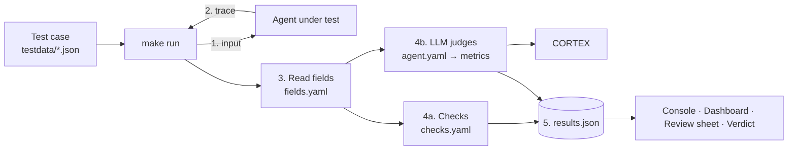

# AI Eval Suite

An **agent-agnostic offline evaluation framework** for AI agents. It sends test questions to an agent,
saves the agent's trace, scores it with deterministic checks and LLM judges, and reports pass / fail
against release targets. Adding an agent is a new folder of YAML under `agents/` — no framework code.

**New here?** Set up with [SETUP.md](SETUP.md), then come back to this page.

| Agent | Folder | Details |
|---|---|---|
| Knowledge Agent — answers colleagues' questions from the knowledge base (RAG) | `agents/knowledge_agent/` | [README](agents/knowledge_agent/README.md) |

## Contents

1. [Why this framework](#why-this-framework)
2. [How it works](#how-it-works)
3. [Project layout](#project-layout)
4. [Everyday commands](#everyday-commands)
5. [Configuring an agent](#configuring-an-agent) — test cases, suites, judges, fields, checks
6. [Building test data](#building-test-data) — spreadsheet import, synthesizer, domains
7. [Reading results](#reading-results)
8. [Release decisions](#release-decisions) — targets, consistency, baseline and verdict, SME calibration
9. [Add an agent](#add-an-agent)
10. [Troubleshooting](#troubleshooting)

---

## Why this framework

LLM agents change with every prompt, model or retrieval tweak, and their answers vary from run to run.
Before a release, the framework answers:

| Question | How |
|---|---|
| Is the answer correct, relevant and grounded? | LLM judges (Pegasus / DeepEval on CORTEX) with a threshold each |
| Did each stage of the agent do its job? | checks and judges on any value in the agent's trace, not only the answer |
| Is it safe? | privacy, hallucination and refusal checks |
| Is this build good enough to ship? | release targets: pass rates across a suite |
| Is it worse than the last good build? | baseline and verdict, over several repetitions |
| Do the judges agree with the experts? | SME review sheet and calibration |

**Offline** means prepared test cases against a test deployment of the agent (or saved traces) —
never live user traffic.

## How it works



For every test case of a suite, `make run AGENT=<agent> SUITE=<suite>`:

1. **Calls the agent** with the case's input (Google ADK over HTTP by default) — or, with `OFFLINE=1`,
   reuses the trace saved last time.
2. **Saves the trace**: the agent's record of every step and the final answer.
3. **Reads fields** from the trace — the answer, but also stage outputs such as rewritten queries or
   retrieved documents. Values the trace only names by id (e.g. a document's text) are fetched by the
   agent's `lookups.py`.
4. **Scores** them with **deterministic checks** (exact yes / no rules, free) and **LLM judges**
   (a 0–1 score from a judge model, pass at or above a threshold).
5. **Reports** pass / fail per case and pass rates against the suite's release targets, and saves
   everything to `outputs/runs/<run id>/results.json`.

Principles:

- **Configuration over code.** Everything agent-specific is YAML in `agents/<agent>/`; `src/` is the same
  for every agent.
- **The trace is the only evidence.** What the agent doesn't log can't be tested.
- **Errors are never scores.** An unreachable agent or judge is an ERROR — never a pass, skip or 0.
- **Repeatable.** Judges run at temperature 0, every run is saved, baselines are committed.

## Project layout

**Top level** — what you work with day to day:

| Path | What it is | You edit it? |
|---|---|---|
| `agents/<agent>/` | everything about one agent (below) | **yes** — this is where all agent work happens |
| `env/.env` | your settings and credentials (created by `make setup`, never committed) | yes, once |
| `Makefile` | every command (`make help`) | rarely |
| `metric_library.yaml` | the built-in judges and which engine runs each | to add a Pegasus / DeepEval metric |
| `baselines/<agent>/` | saved baselines, committed so the team compares against the same one | via `make baseline` |
| `outputs/` | traces, run results, review sheets, exports (not committed) | no — generated |
| `src/` | the framework code (below) | no — not needed to onboard an agent |
| `tests/` | the framework's own tests (`make test`) | when changing `src/` |

**An agent's folder** — `agents/<agent>/`:

| File | What it holds | Needed? |
|---|---|---|
| `agent.yaml` | connection, judges and thresholds, suites, release targets | **required** |
| `testdata/<suite>/*.json` | test cases, one per file | **required** |
| `fields.yaml` | what to read from the trace | for stage checks / judges |
| `checks.yaml` | deterministic checks, in groups | optional |
| `rubrics/*.md` | criteria for custom judges, in plain English | optional |
| `README.md` | what the agent does and how it is evaluated | recommended |
| `domains.yaml` | business areas: official names and aliases | if cases are grouped by area |
| `importers/*.yaml` | spreadsheet column mapping for `make import-cases` | optional |
| `synth/` | test case generator settings for `make goldens` | optional |
| `lookups.py` | fetch values outside the trace by id (e.g. document text) | optional |
| `client.py` | only for agents that are not Google ADK | rare |

**Framework code** — `src/`, in the order a run uses it:

| Folder | Does |
|---|---|
| `cli.py` | entry point for every `make` command |
| `runners/` | runs a suite: loads cases, calls the agent, scores, saves |
| `clients/` | talks to the agent (ADK), the judge model (CORTEX) and Athena |
| `fields/` | reads fields from traces, runs checks and lookups |
| `metrics/` | the LLM judges (Pegasus, DeepEval) |
| `reporting/` | console report, dashboard, review sheet, calibration |
| `verdict/` | baseline and verdict |
| `importers/`, `exporters/`, `synthesizer/` | building test data |
| `core/`, `onboarding/`, `utils/` | settings, config loading, `make new-agent`, `make doctor`, helpers |

Every file starts with a comment saying what it does. To read the code, start at
`src/runners/suite_runner.py`.

## Everyday commands

| I want to… | Command |
|---|---|
| check my machine is ready | `make doctor` |
| list agents, suites and judges | `make list` |
| run a suite | `make run AGENT=<agent> SUITE=<suite>` |
| … only some cases / without calling the agent / without judges / repeated | add `CASE="ID1 ID2"` / `OFFLINE=1` / `JUDGES=0` / `REPS=5` |
| … only some judges | add `METRICS="faithfulness"` |
| see what is read from a trace | `make fields AGENT=<agent> CASE=<id>` |
| open the dashboard | `make dashboard` |
| pass rates over the last N runs | `make summary AGENT=<agent> SUITE=<suite> LAST=10` |
| save a baseline / check a new build | `make baseline … BUILD=1.4.0 REPS=5` / `make verdict … BUILD=1.5.0 REPS=5` |
| spreadsheet → test cases / test cases → Excel | `make import-cases AGENT=<agent> FILE=… [DRY_RUN=1]` / `make export-cases AGENT=<agent>` |
| generate test cases | `make sources AGENT=<agent>`, then `make goldens AGENT=<agent>` |
| SME review sheet / judge agreement | `make review-sheet AGENT=<agent> SUITE=<suite>` / `make calibrate FILE=…` |
| share a run as one HTML file (the dashboard, offline) | `make report AGENT=<agent> SUITE=<suite> [RUN=<run id>]`, or **Download HTML report** in the dashboard |
| create an agent | `make new-agent NAME=<name> INPUT_FIELD=question` |
| test the framework | `make test` |

Every command exits with 1 when something failed, so it works in CI. A live case takes as long as the
agent plus one call per judge — try one case (`CASE=`) before a full run.

## Configuring an agent

### Test cases

```json
{
  "test_case_id": "TC_012",
  "input":    { "question": "Can a customer get a refund after 30 days?", "question_type": "yes_no" },
  "expected": { "expected_answer": "No. Refunds are only possible within 30 days, except ...",
                "expected_source_ids": ["8194"] },
  "metadata": { "approval_status": "APPROVED" }
}
```

`input` is sent to the agent (`message:` in `agent.yaml` says which keys). Everything in `expected` is
optional: a judge or check that needs a value the case doesn't have is **skipped**, not failed.

### Suites, judges and targets — `agent.yaml`

```yaml
metrics:                                      # every judge this agent can use, with its threshold
  relevance:    {threshold: 0.7}              # built-in (metric_library.yaml)
  correctness:  {threshold: 0.7}
  intent_preservation:                        # custom judge: a rubric in plain English
    rubric: rubrics/intent_preservation.md
    answer: rewritten_query                   # judge a stage output, not the final answer

suites:                                       # each suite = cases + the judges and checks it runs
  sanity:
    metrics: [relevance]
    targets: {case_pass_rate: 1.0}
  golden:
    metrics: [correctness, relevance]
    checks: [answer, retrieval]               # check groups or names (default: all)
    targets: {correctness: 0.90, error_rate: 0.05}
  consistency:
    testdata: testdata/golden                 # reuse another suite's cases …
    only: {metadata.consistency_set: true}    # … only those that match
    metrics: [correctness]
```

Give each suite **one question to answer** and only the judges that answer it — judges cost a model call
per case, checks are free. A typical set: sanity (every deploy), golden (release gate), consistency,
coverage (generated cases), negative and safety, diagnose (on demand).

**Judges.** Built-ins (`metric_library.yaml`): relevance, faithfulness, correctness, context precision /
recall, hallucination, privacy leakage, response alignment, and a few DeepEval-only ones. A built-in runs
on **Pegasus** when installed, otherwise **DeepEval**; a rubric runs on DeepEval GEval. Judges see the
`question`, `answer`, `contexts` (retrieved text) and `expected_answer`; `answer: <field>` points a judge
at any other field. Each result records which engine scored it.

### Reading the trace — `fields.yaml`

One line per value, as a [JMESPath](https://jmespath.org) query on the trace:

```yaml
fields:
  answer:          {path: final.answer, required: true}     # missing -> case ERROR, not silent skips
  rewritten_query: state.rewritten_query                    # a stage output from session state
  retrieved_ids:   "state.search_results[].doc_id"
  contexts:        {lookup: get_document_text, ids: retrieved_ids}   # text fetched by lookups.py
```

The trace is first flattened into `final` (final output), `state` (session state), `nodes`, `models`,
`messages`, `timing` and `trace`. Options are documented at the top of `src/fields/extract.py`.
**When the agent's trace format changes:** `make fields AGENT=<agent> CASE=<id>`, then fix whatever
shows `NOT FOUND`.

### Deterministic checks — `checks.yaml`

```yaml
checks:
  answer:                                     # a group (suites pick groups or names)
    within_60s: {type: range, field: latency_ms, max: 60000, diagnostic: true, banner: true}   # orange warning
    within_90s: {type: range, field: latency_ms, max: 90000, banner: true}                     # red, fails the case
    cites_only_evidence: {type: subset, field: cited_ids, of: [retrieved_ids]}
  retrieval:
    search_recall_at_5:
      type: recall
      k: 5
      diagnostic: true                        # shown on the case, never fails it
      compare: [{field: retrieved_ids, expected: expected_source_ids}]
```

Types: `present`, `equals`, `one_of`, `contains`, `not_contains`, `not_matches`, `min_words`, `range`,
`same_count`, `subset`, `any_in`, `all_in`, `precision`, `recall`, `ndcg` (options at the top of
`src/fields/checks.py`). `when:` limits a check to some cases. `banner: true` also shows a failure as a
box at the top of the case: red when it fails the case, orange when the check is diagnostic. A case can expect a refusal
(`"expected_error": ["InsufficientContextError"]`): the agent's error is then kept as its answer and
checked, instead of the case being an ERROR.

## Building test data

**From a spreadsheet** — `make import-cases AGENT=<agent> FILE="golden.xlsx" [DRY_RUN=1]`. The column
mapping is per agent in `importers/<name>.yaml`. The sheet is the source of truth: re-importing updates
the files, empty cells are left out, and the import stops on a missing column or a duplicate id.
`make export-cases` does the reverse: one formatted Excel workbook, a sheet per suite.

**Generated** — `make sources`, then `make goldens AGENT=<agent> [GROUP=…] [IDS=…] [STYLES=…]`. DeepEval's
Synthesizer writes questions and reference answers from source documents (Athena pages, a folder of
files, or a JSON export), one style file per kind of question, in the shape set in `synth/synth.yaml`.
A style can set its own `output:` (folder, id, extra fields) and its own `evolutions:` (DeepEval's
question rewriting; `{rounds: 0}` keeps a simple question simple). Generated cases start as `UNREVIEWED`;
a suite can keep only approved ones with `only: {metadata.approval_status: APPROVED}`.

**Domains** — agents that work per business area list them once in `domains.yaml`
(`Customer Vulnerability Hub: [CVH]` = official name and aliases). The importer and the synthesizer then
name every case the same way: `{domain_path}` `Customer_Vulnerability_Hub` (sent to the agent),
`{domain}` `CUSTOMER_VULNERABILITY_HUB` (ids), `{domain_folder}` `customer_vulnerability_hub` (folders).

## Reading results

| Where | What |
|---|---|
| Console | per case `PASS` / `FAIL` / `ERROR` with the reason, pass rates, release targets (MET / MISSED) |
| `outputs/runs/<run id>/results.json` | everything: every check and judge, score, reason, every field read |
| `make dashboard` | Overview, Test cases (answer, evidence, judges, checks, raw trace), Consistency, Trends, Baseline |
| `make report` | the same views as one self-contained HTML file in `outputs/reports/`, to email or attach — opens in any browser |

| Status | Meaning |
|---|---|
| PASS | check passed, or judge score ≥ threshold |
| FAIL | check failed, or judge score below threshold → the case fails |
| SKIP | the case lacks the data this check / judge needs — no effect |
| ERROR | the agent or judge couldn't run (network, auth, trace format) → the case errors |

**When a case fails:** read the reason → `make fields … CASE=<id>` to see the values checked → decide:
agent bug (report it with the trace), wrong test data (fix the case), or wrong check / threshold (agree
the change with the team).

## Release decisions

**Targets** — thresholds decide pass / fail per case; targets decide whether the **run** is good enough:

```yaml
golden:
  targets: {correctness: 0.90, within_60s: 0.95, error_rate: 0.05, case_pass_rate: 0.90}
```

A missed target (or one with no result) shows as MISSED and fails `make verdict`.

**Consistency** (`REPS > 1`) — the same question asked several times must give the same key values
(e.g. the documents the answer stands on) and pass the listed judges every time:
`consistency: {same: <field>, all_pass: [correctness]}` in `agent.yaml`.

**Baseline and verdict** — `make baseline` on a build you trust (commit `baselines/`), then
`make verdict` on the new build. The verdict fails when a pass rate drops by 15 points or more, a mean
judge score drops by 0.10 or more, something no longer runs, or a target is missed. The dashboard shows
it as a release view: what regressed, what improved, both builds side by side.

**Judge calibration** — judges are LLMs, so check them against people: `make review-sheet` writes an
Excel sheet of answers and judge scores; an SME marks ~20+ rows pass / fail; `make calibrate FILE=…`
reports agreement, false passes and the threshold that would agree best.

## Add an agent

```bash
make new-agent NAME=claims_agent INPUT_FIELD=claim_id
```

1. Put its URL in `env/.env` and fill in `agents/claims_agent/agent.yaml` (judges, suites).
2. Add test cases to `testdata/sanity/` — by hand, from a spreadsheet, or generated.
3. `make run AGENT=claims_agent SUITE=sanity`, then `make fields AGENT=claims_agent` to see its trace.
4. Add `fields.yaml` and `checks.yaml` for stage-level checks.
5. Write `agents/claims_agent/README.md`: what the agent does and how it is evaluated.

Not a Google ADK agent? Rename `client.py.example` to `client.py` and fill in its three TODOs.
`agents/knowledge_agent/` is a complete example.

## Troubleshooting

Setup problems (installs, certificates, CORTEX sign-in): [SETUP.md → Problems](SETUP.md#problems-during-setup).

| You see | Fix |
|---|---|
| case `ERROR`: `required field(s) … not found in the trace` | the trace format changed: `make fields … CASE=<id>`, fix the `NOT FOUND` paths in `fields.yaml` |
| load error naming a file and key (`unknown keys`, `not fields in fields.yaml`) | a typo in `agent.yaml` / `checks.yaml` / `fields.yaml` |
| a judge always SKIP (e.g. correctness) | the cases have no `expected_answer` |
| a check always SKIP | the cases lack the expected value it compares with, or its `when:` never holds |
| `make import-cases`: header not found / duplicate id | wrong tab (`SHEET=`), a renamed column, or a repeated Test ID in the sheet |
| `make verdict` fails with no regression shown | a release target was missed — read the Targets block |
| dashboard: "No runs yet" | run the suite first |
