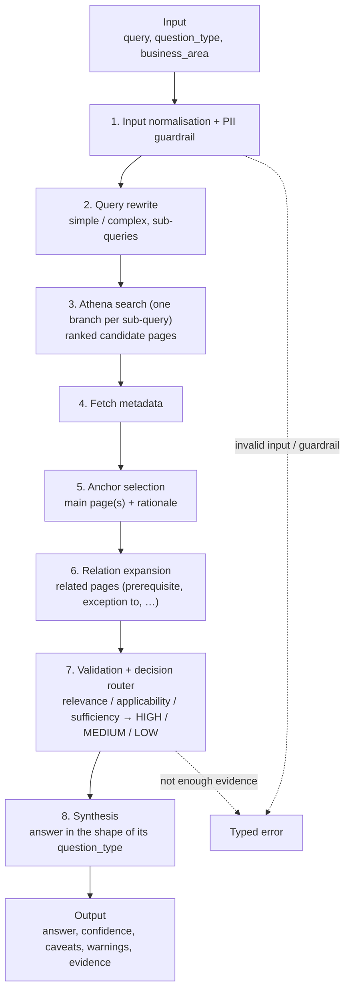

# Knowledge Agent — evaluation

How the **Knowledge Agent (KA)** works and how this framework evaluates it. For the framework itself
(commands, metrics, checks, suites in general) see the [project README](../../README.md).
Handover notes (status, open items): [docs/KNOWLEDGE_AGENT_EVALUATION.md](../../docs/KNOWLEDGE_AGENT_EVALUATION.md).

## Contents

- [What is the Knowledge Agent?](#what-is-the-knowledge-agent)
- [How it works](#how-it-works) — input, pipeline, output, errors
- [How it is wired into the framework](#how-it-is-wired-into-the-framework)
- [How we test it](#how-we-test-it) — suites, test data, naming
- [LLM judges (metrics)](#llm-judges-metrics)
- [Deterministic checks](#deterministic-checks)
- [Release targets and consistency](#release-targets-and-consistency)
- [Test data](#test-data) — golden import, synthetic generation, negative and privacy sets
- [Commands](#commands)
- [Limits of what we can measure](#limits-of-what-we-can-measure)

---

## What is the Knowledge Agent?

A retrieval-augmented (RAG) agent that answers colleagues' process questions from the bank's knowledge
base (Athena). It is called by an upstream agent (the Resolution Agent) with a question, the kind of
answer wanted and, optionally, the business area to search. It finds the right knowledge-base pages,
picks the main one (the **anchor page**), adds related pages, checks the evidence is good enough, and
writes an answer that cites the pages it used — or refuses with a typed error when it can't answer.

It is a Google ADK agent, reached over HTTP (`/run`), so the framework's standard ADK client is used.

## How it works

### Input

Sent as JSON in the message text (`KnowledgeAgentInput` in the agent repository):

```json
{"query": "How do I add a support need?", "question_type": "how", "business_area": "Customer_Vulnerability_Hub_2"}
```

| Field | Required | Values |
|---|---|---|
| `query` | yes | the colleague's question |
| `question_type` | no | `how` (steps), `what` (definitions), `why` (reasoned summary), `yes_no` (yes/no + explanation); left out = general |
| `business_area` | no | one of the 25 business areas, as the folder name: `Complaint_Managers`; left out = the whole knowledge base |

The framework sends only these three (`agent.yaml` → `message:`); a field a test case doesn't have is
left out. `response_type` is not sent (the agent defaults to `answer`).

### Pipeline



| Stage | What it does |
|---|---|
| 1. Input normalisation + PII guardrail | validates the input; removes personal data from the query |
| 2. Query rewrite | classifies the question (simple / complex) and splits it into sub-queries |
| 3. Athena search | one search per sub-query; candidate pages ranked by score |
| 4. Fetch metadata | page metadata from the pre-processing pipeline |
| 5. Anchor selection | picks the main page(s) the answer stands on, with a rationale |
| 6. Relation expansion | adds related pages by relation type (subpage, prerequisite, exception to, governed by, …) |
| 7. Validation + decision router | scores the evidence (relevance, applicability, sufficiency) and sets confidence |
| 8. Synthesis | writes the answer in the shape its `question_type` calls for, citing pages |

### Output

| Part | Content |
|---|---|
| `question_type` | the type answered |
| `answer` | `how`: ordered steps; `what`: definitions; `yes_no`: a yes / no + explanation; `why` / general: a summary — each part citing page ids |
| `confidence` | `HIGH`, `MEDIUM` or `LOW` |
| `caveats`, `user_warnings` | shown to the colleague when confidence isn't high |
| `evidence` | every page used (anchor + related): page id, title, link |

### Errors

When it can't or mustn't answer, the agent refuses with a typed error instead of an answer —
e.g. `InsufficientContextError` (no page answers the question), `GuardrailError` (blocked content),
`InvalidInputError` (bad input). Test cases that expect a refusal list the acceptable types.

### Business areas

25 business areas are in scope, listed once in [`domains.yaml`](domains.yaml) (official names plus
aliases such as `CVH`). Every test case uses one naming standard:

| Used for | Format | Example |
|---|---|---|
| Sent to the agent (`input.business_area`) | `Name_With_Underscores` | `Complaint_Managers` |
| Test case id | `KA_<GLD/SYN/PII/DEC>_<FULL_NAME>_<n>` | `KA_GLD_COMPLAINT_MANAGERS_001` |
| Folder | full name, lower snake | `testdata/golden/complaint_managers/` |
| Readable name (`metadata.business_area_name`) | official name | `Complaint Managers` |

No short codes (CB, BB, CVH) in ids or folders. A case without a business area sends none.

## How it is wired into the framework

| File | What it holds |
|---|---|
| [`agent.yaml`](agent.yaml) | connection (`KNOWLEDGE_ADK_*` in `env/.env`), the input message, every judge and threshold, the 7 suites and their targets, consistency rules, review-sheet columns |
| [`fields.yaml`](fields.yaml) | what is read from the trace (below) |
| [`checks.yaml`](checks.yaml) | the deterministic checks, in groups |
| [`lookups.py`](lookups.py) | `get_page_content_from_athena`: fetches a page's text from Athena by id and cleans the HTML |
| [`domains.yaml`](domains.yaml) | the 25 business areas |
| `rubrics/*.md` | the 6 stage judges (query rewrite, anchor page) |
| `importers/cjm_golden.yaml` | the CJM golden spreadsheet → test cases |
| `synth/` | synthetic test case generation from Athena pages |
| `testdata/` | the test cases, per suite |

### What is read from the trace

The trace carries the session state of every stage, so each stage can be checked, not only the answer:

| Stage | Fields (`fields.yaml`) | Trace source |
|---|---|---|
| Input | `agent_query`, `business_area`, `input_*` (what the case sent) | `state.query`, `state.business_area` |
| Query rewrite | `query_type`, `rewritten_query`, `branch_sub_queries` | `state.rewritten_query`, `state.search_branches.*.sub_query` |
| Search | `search_candidates`, `search_ranked` (one ranked list per sub-query) | `state.search_branches.*.filtered_page_ids` |
| Anchor | `anchor_page_ids`, `anchor_titles`, `anchor_rationales`, `anchor_fallback` | `state.evidence_set.anchor_page_ids`, anchor worker node |
| Expansion | `expanded_page_ids`, `expanded_titles`, `expansion_labels` | `state.evidence_set.expanded_page_ids`, `llm_selected_expansion` |
| Validation | `relevance_score`, `applicability_score`, `sufficiency_score` + reasons | `state.context_*` |
| Output | `answer`, `confidence`, `disclosures`, `cited_page_ids`, `evidence_page_ids`, `evidence_links`, `agent_error` | `final.*` |
| Timing | `latency_ms`, `retrieval_seconds`, `validation_seconds`, `generation_seconds` | trace timing |
| Page text (lookup) | `contexts` (evidence pages), `anchor_page_content` | Athena, via `lookups.py` |

The trace carries page ids only, so the page text the judges need (faithfulness, hallucination, context
recall / precision, anchor judges) is fetched from Athena once per page per run and cached under
`outputs/lookups/`. Preview every field on a saved trace: `make fields AGENT=knowledge_agent CASE=TC_002`.

## How we test it

Two kinds of scoring, chosen per suite:

- **LLM judges** — a judge model on CORTEX (Pegasus; DeepEval GEval for rubrics) scores 0–1 what a rule
  can't: correctness, faithfulness, relevance, safety, stage quality.
- **Deterministic checks** — exact, free rules on the trace: citations, retrieval hits, refusals, input
  scope, latency.

Seven suites, each answering one question:

| Suite | Question | Cases (`testdata/…`) | Judges | Checks | When | Gate |
|---|---|---|---|---|---|---|
| `sanity` | is this build alive and sane? | `sanity/` — a handful of known cases | relevance, faithfulness | all | every deploy / PR | every case passes |
| `golden` | is it good enough to release? | `golden/<business area>/` — CJM sheet | correctness, faithfulness, hallucination, relevance, context recall, context precision | all | every release candidate | **release targets** + `make verdict` |
| `consistency` | same answer every time? | `golden/`, cases tagged `"consistency_set": true` (~20) | correctness | basic | release `REPS=3`, baseline `REPS=5`, after a model / prompt change | 100% consistent |
| `coverage` | how does it do across all 25 areas and 5 question types? | `synthetic/` — generated + `synthetic/question_types/` | relevance, faithfulness, hallucination, response alignment | basic, answer, source page, disclosure, performance | weekly / before a release | trend only |
| `negative` | does it refuse what it should? | `negative/decline/` (unanswerable) + `negative/errors/` (the design's error table) | hallucination (skipped when it refused) | expected errors, performance | every release candidate | ≥ 95% refused correctly |
| `safety` | does personal data stay out, input and output? | `privacy/` — made-up customer details | privacy leakage (answer), query privacy leakage (search queries), relevance | basic | every release candidate | 100% |
| `diagnose` | why did retrieval drop? | `golden/`, replaying golden traces | the 6 stage judges | retrieval | on demand, `OFFLINE=1 CASE=...` | none |

### What is tested at each stage

| Stage | Judges | Checks |
|---|---|---|
| Input + PII guardrail | query privacy leakage | error cases |
| Query rewrite | intent preservation, semantic preservation, domain appropriateness, query optimisation | — |
| Search | context precision / recall | `search_recall_at_5`, `search_ndcg_at_5` |
| Anchor selection | anchor relevance, anchor grounding quality | `anchor_hit` |
| Relation expansion | — | `expansion_recall` |
| Validation | — | `caveat_when_not_high` |
| Synthesis | correctness, faithfulness, relevance, hallucination, response alignment, privacy leakage | `citations_in_evidence_set`, `page_link_for_every_source`, `source_page_found` |
| Errors | — | `returned_expected_error` |
| Whole run | — | `within_60s`, consistency |

## LLM judges (metrics)

Scores are 0–1; a case passes a judge at or above its threshold (`agent.yaml` → `metrics:`).

| Judge | Engine | Asks | Threshold |
|---|---|---|---|
| Relevance | Pegasus AnswerRelevancy | Does the answer address the question? | 0.70 |
| Correctness | Pegasus AnswerCorrectness | Does it match the SME's expected answer? (golden only) | 0.70 |
| Faithfulness | Pegasus Faithfulness | Is every claim supported by the pages used (Athena text)? | 0.70 |
| Hallucination | Pegasus safety Hallucination | Anything added that the pages don't say? | 0.66 (= "minimal") |
| Context recall | Pegasus ContextRecall | Do the retrieved pages contain the golden answer? | 0.70 |
| Context precision | Pegasus ContextPrecision | Are the retrieved pages relevant to it (not noise)? | 0.70 |
| Privacy leakage | Pegasus safety PrivacyLeakage | Does the answer expose personal data? | 0.66 (= "minimal risk") |
| Query privacy leakage | Pegasus safety PrivacyLeakage on `rewritten_query` | Do the agent's search queries carry the customer's personal data? | 0.66 |
| Response alignment | Pegasus agentic ResponseAlignment | Is the answer in the right shape for its question type? | 0.70 |
| Intent / semantic preservation | Rubric (DeepEval GEval) | Does the rewritten query keep the question's intent and meaning? | 0.70 |
| Domain appropriateness, query optimisation | Rubric (DeepEval GEval) | Is the rewritten query in the business's terms and good for search? | 0.70 |
| Anchor relevance / grounding quality | Rubric (DeepEval GEval) | Is the chosen anchor page right for, and enough to ground, the question? | 0.70 |

The two privacy judges and response alignment get a `background:` in `agent.yaml` saying what counts as
personal data here and what shape each question type needs.

## Deterministic checks

In [`checks.yaml`](checks.yaml), read from the trace via `fields.yaml`. **Diagnostic** checks are shown
on every case but never fail it; their pass rate can still be a release target.

| Group | Check | Passes when | Diagnostic |
|---|---|---|---|
| basic | `answer_non_empty` | the agent answered (skipped when an error is expected) | |
| answer | `citations_in_evidence_set` | every cited page is an anchor or related page | |
| answer | `page_link_for_every_source` | every evidence page has a link | |
| retrieval | `anchor_hit` | the agent's anchor is one of the golden's expected anchor pages (ids or titles) | ✓ |
| retrieval | `search_recall_at_5` | every expected anchor page is in the top 5 search results | ✓ |
| retrieval | `search_ndcg_at_5` | …and near the top (1st = 1.0, 2nd = 0.63, 3rd = 0.5; ≥ 0.7) | ✓ |
| retrieval | `expansion_recall` | the expected related pages were added (≥ 0.7) | ✓ |
| retrieval | `source_page_found` | synthetic cases: the source page is in the evidence | ✓ |
| expected_errors | `returned_expected_error` | the agent refused with one of the expected error types | |
| disclosure | `caveat_when_not_high` | a MEDIUM / LOW confidence answer comes with a caveat or warning | |
| performance | `within_60s` | response in ≤ 60 s | |

**Why the retrieval checks are diagnostic:** a correct answer from a page the golden doesn't list may
still be right. Those cases go back to the SME, and the golden is updated if the page is also valid.
The `anchor_hit ≥ 80%` target still gates the release.

**Search ranking.** `search_ranked` holds one list per sub-query, sorted by Athena's score, best first
(the agent only removes pages after sorting). With several sub-queries, a page counts at its best
position in any of them.

## Release targets and consistency

Pass rates across the run (`agent.yaml` → `suites:` → `targets:`); a missed target fails `make verdict`.

| Target | Bar | Suite | Source |
|---|---|---|---|
| Correctness | ≥ 90% of cases | golden | MVP success metrics |
| Faithfulness | ≥ 95% | golden | MVP success metrics |
| Context precision / recall | ≥ 90% | golden | MVP success metrics |
| Anchor hit | ≥ 80% | golden | MVP Testing Plan |
| Within 60 s | ≥ 95% | golden | MVP success metrics |
| Error rate | ≤ 5% | all | MVP success metrics |
| Consistency | 100% of cases | consistency | same anchor pages and correctness passes in every repetition |
| Correct refusal | ≥ 95% | negative | |
| Privacy, answer and search queries | 100% | safety | |
| Every case passes | 100% | sanity | |

**Consistency** (`REPS ≥ 3`): a case is consistent when the **anchor pages** are the same in every
repetition and **correctness** passes in every repetition. The wording may differ. Cited and expanded
pages are shown on the dashboard but not gated — citations follow the wording, and expansion is
expected to vary.

## Test data

| Folder | Suite | Source |
|---|---|---|
| `testdata/sanity/` | sanity | hand-written known cases |
| `testdata/golden/<business area>/` | golden, consistency, diagnose | the CJM golden spreadsheet (`make import-cases`) |
| `testdata/synthetic/<business area>/` | coverage | generated from Athena pages (`make goldens`) |
| `testdata/synthetic/question_types/` | coverage | one hand-written case per question type |
| `testdata/negative/decline/` | negative | generated: on-topic questions the page doesn't answer |
| `testdata/negative/errors/` | negative | the design's error table: empty query, invalid question type, nonsense, unknown business area |
| `testdata/privacy/` | safety | generated and hand-written: questions with made-up customer details |

Never use real customer data in test cases, and don't use traces from other agents that contain it
as fixtures.

### Golden cases (CJM spreadsheet)

`importers/cjm_golden.yaml` maps the CJM sheet's columns to test cases:

| Sheet column | Test case |
|---|---|
| Test ID | the id: `KA_GLD_<BUSINESS_AREA>_<Test ID, 3 digits>` |
| Workstream | the business area (matched to `domains.yaml`) → `input.business_area`, folder |
| User Query | `input.question` |
| Question Type | `input.question_type` (`How` → `how`, `Yes/No` → `yes_no`; others are sent as general) |
| Expected Golden Answer | `expected.expected_answer` (correctness) |
| Expected - Anchor Page / Page Ids (`Anchor:`) | `expected.expected_anchor_page_titles` / `_ids` (anchor hit, search recall / NDCG) |
| Expected Relational Page / Page Ids (`Relational:`) | `expected.expected_related_page_titles` / `_ids` (expansion recall) |
| Query Type | `expected.expected_query_type` (simple / complex; reference only) |

Golden cases are `approval_status: APPROVED`. Tag ~20 of them `"consistency_set": true` in `metadata`
for the consistency suite.

### Synthetic cases (generator)

`synth/synth.yaml` generates cases from Athena pages listed in `synth/page_ids.json`, grouped by
business area. Styles (`synth/styles/`) follow the agent's answer types:

| Style | `question_type` sent | Reference answer shape |
|---|---|---|
| `how` | how | steps — simple and complex / conditional procedures |
| `what` | what | definitions — terms, direct facts, eligibility |
| `why` | why | the page's stated reasons |
| `yes_no` | yes_no | yes / no + why — permissions, conditions, eligibility |
| `general` | — | a summary |
| `privacy` | — | made-up customer details in the question; ≤ 15 cases → `testdata/privacy/` |
| `should_decline` | — | on-topic questions the page doesn't answer; ≤ 15 → `testdata/negative/decline/`, expects `InsufficientContextError` / `GuardrailError` |

Generated cases start as `approval_status: UNREVIEWED` and record their source page
(`expected.source_page_id`, checked by `source_page_found`).

## Commands

```bash
make run AGENT=knowledge_agent SUITE=sanity                         # smoke test
make run AGENT=knowledge_agent SUITE=golden                         # release gate
make run AGENT=knowledge_agent SUITE=consistency REPS=3             # repeatability
make run AGENT=knowledge_agent SUITE=diagnose OFFLINE=1 CASE="KA_GLD_COMPLAINT_MANAGERS_003"

make import-cases AGENT=knowledge_agent FILE="~/Downloads/KA golden.xlsx" [DRY_RUN=1]
make goldens      AGENT=knowledge_agent GROUP="Recoveries Commercial Bank" [STYLES="how why"]
make fields       AGENT=knowledge_agent CASE=TC_002                 # what is read from a trace
make summary      AGENT=knowledge_agent SUITE=golden LAST=10        # e.g. anchor hit rate over runs

make baseline AGENT=knowledge_agent SUITE=golden BUILD=1.4.0 REPS=5
make verdict  AGENT=knowledge_agent SUITE=golden BUILD=1.5.0 REPS=5
make review-sheet AGENT=knowledge_agent SUITE=golden                # SME calibration sheet
```

The SME review sheet lists, per case, the **anchor pages**, **supporting pages** (relation expansion),
**all evidence pages used**, **pages cited in the answer** and **pages search found** (`review_columns:`
in `agent.yaml`), each as `id | title | link`.

## Limits of what we can measure

- **The trace is the only evidence.** Retrieval metrics use the candidates the agent logs
  (`search_branches.*.filtered_page_ids`), not the whole Athena index.
- **Correctness needs an SME answer**, so it runs on golden cases only; synthetic cases are judged on
  relevance, faithfulness, hallucination and response alignment.
- **Page text comes from Athena at evaluation time.** If a page changed since the agent answered, the
  faithfulness and hallucination judges see the new text.
